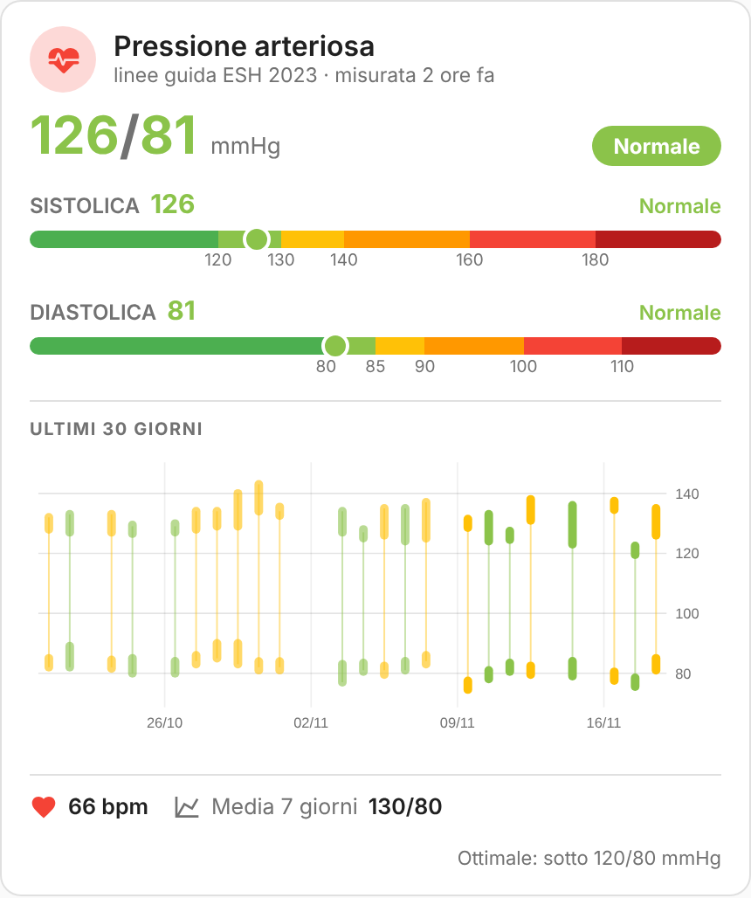

# Blood Pressure Card

[](https://hacs.xyz/docs/faq/custom_repositories/)
[](https://github.com/artech-lab/blood-pressure-card/releases)
[](https://github.com/artech-lab/blood-pressure-card/actions/workflows/validate.yml)
[](LICENSE)

[English](README.md) | **Italiano**

Una card per le plance di Home Assistant dedicata ai misuratori di pressione: l'ultima misurazione sulle
fasce della linea guida **ESH 2023**, **ESC 2024** o **ACC/AHA 2025**, la categoria, il battito, la media di
7 giorni e lo storico giornaliero. Aggiungila e trova da sola il tuo misuratore (Withings, Omron, Health
Connect, ESPHome o qualsiasi altra integrazione): niente helper, niente YAML, nessun riavvio.



<sub>Immagini realizzate con dati dimostrativi inventati.</sub>

## Funzionalità

- **Nessuna configurazione**: i sensori di sistolica, diastolica e battito vengono trovati in automatico, in
  qualsiasi lingua. Con più misuratori scegli i sensori nell'editor visuale.
- **Fasce della linea guida**: sistolica e diastolica su fasce colorate con le soglie della linea guida
  scelta, la categoria di ciascun valore e della misurazione. Se i due valori cadono in categorie diverse
  vale la più alta, come prescrivono tutte e tre le linee guida.
- **Storico giornaliero** (7–365 giorni): una capsula per valore dalla misurazione più bassa alla più alta
  del giorno, colorata secondo la categoria della media del giorno; tooltip con minimo, media, massimo e
  numero di misurazioni.
- **Misurazioni esatte**: finché il recorder le conserva (10 giorni di default) lo storico è costruito dalle
  misurazioni reali; i giorni più vecchi arrivano dalle statistiche a lungo termine. I valori ripristinati
  dopo un riavvio non contano come misurazioni.
- **Battito**, **media di 7 giorni** e **ora dell'ultima misurazione**.
- **Italiano e inglese**, secondo la lingua e il formato delle date del profilo di Home Assistant.
- **Aspetto nativo**: colori del tema, modalità chiara e scura, layout a sezioni, accessibile da tastiera,
  editor visuale per ogni opzione.

## Requisiti

- Home Assistant 2024.8 o successivo.
- Un misuratore di pressione che espone sistolica e diastolica come sensori in **mmHg** (il sensore del
  battito è facoltativo). Per lo storico oltre la conservazione del recorder i sensori devono avere uno
  `state_class`, come quelli della maggior parte delle integrazioni.

## Installazione

### HACS (consigliata)

[](https://my.home-assistant.io/redirect/hacs_repository/?owner=artech-lab&repository=blood-pressure-card&category=plugin)

1. In HACS (*Marketplace* da Home Assistant 2026.11) cerca **Blood Pressure Card**. Se non compare,
   aggiungi `https://github.com/artech-lab/blood-pressure-card` come repository personalizzato di tipo
   **Dashboard**.
2. Scaricala. HACS aggiunge da solo la risorsa della plancia.
3. Ricarica la pagina del browser.

### Manuale

1. Scarica `blood-pressure-card.js` dall'[ultima release](https://github.com/artech-lab/blood-pressure-card/releases/latest)
   e copialo in `/config/www/`.
2. *Impostazioni → Plance → ⋮ → Risorse → Aggiungi risorsa*: URL `/local/blood-pressure-card.js`, tipo
   **Modulo JavaScript**.
3. Ricarica la pagina del browser.

## Utilizzo

In una plancia: *Modifica → Aggiungi scheda → Blood Pressure Card*. Non serve altro:

```yaml
type: custom:blood-pressure-card
```

Tocca i valori o una fascia per aprire il sensore, il cuore per aprire il sensore del battito. Passa sopra
lo storico (o toccalo) per i dettagli di un giorno.

## Configurazione

Tutte le opzioni sono facoltative e disponibili nell'editor visuale.

| Opzione | Predefinito | Descrizione |
| --- | --- | --- |
| `systolic_entity` | trovato in automatico | Sensore della pressione sistolica (mmHg). |
| `diastolic_entity` | trovato in automatico | Sensore della pressione diastolica (mmHg). |
| `pulse_entity` | trovato sullo stesso dispositivo | Sensore del battito (bpm). Cercato solo se i sensori di pressione non sono configurati. |
| `guideline` | `esh_2023` (`acc_aha_2025` se il paese di Home Assistant sono gli Stati Uniti) | `esh_2023`, `esc_2024` o `acc_aha_2025`. |
| `title` | "Pressione arteriosa" (tradotto) | Titolo della card. |
| `icon` | `mdi:heart-pulse` | Icona dell'intestazione. |
| `history_days` | `30` | Giorni del grafico storico (7–365). |
| `show_history` | `true` | Grafico dello storico giornaliero. |
| `show_average` | `true` | Media 7 giorni: media delle medie giornaliere degli ultimi 7 giorni. |
| `show_reference` | `true` | Limite superiore della categoria più bassa della linea guida. |

Vedi [`examples/`](examples) per una configurazione completa. Le opzioni `sys_entity` e `dia_entity` delle
versioni inline precedenti funzionano ancora; l'editor visuale le rinomina al salvataggio.

## Le linee guida

Valori in mmHg. Una misurazione assume la categoria più alta raggiunta da uno dei due valori.

**ESH 2023** (European Society of Hypertension) [1]

| Categoria | Sistolica | | Diastolica |
| --- | --- | --- | --- |
| Ottimale | < 120 | e | < 80 |
| Normale | 120–129 | e/o | 80–84 |
| Normale-alta | 130–139 | e/o | 85–89 |
| Ipertensione di grado 1 | 140–159 | e/o | 90–99 |
| Ipertensione di grado 2 | 160–179 | e/o | 100–109 |
| Ipertensione di grado 3 | ≥ 180 | e/o | ≥ 110 |

**ESC 2024** (European Society of Cardiology) [2]

| Categoria | Sistolica | | Diastolica |
| --- | --- | --- | --- |
| Non elevata | < 120 | e | < 70 |
| Elevata | 120–139 | o | 70–89 |
| Ipertensione | ≥ 140 | o | ≥ 90 |

**ACC/AHA 2025** (American College of Cardiology / American Heart Association, stesse categorie del
2017) [3]

| Categoria | Sistolica | | Diastolica |
| --- | --- | --- | --- |
| Normale | < 120 | e | < 80 |
| Elevata | 120–129 | e | < 80 |
| Ipertensione stadio 1 | 130–139 | o | 80–89 |
| Ipertensione stadio 2 | ≥ 140 | o | ≥ 90 |

## Come vengono trovati il misuratore e le misurazioni

- **Sensori**: sensori in mmHg il cui entity id, nome o chiave di traduzione contiene *sistolica* /
  *diastolica* (anche *systolic* / *diastolic*), preferendo una coppia sullo stesso dispositivo; il battito è
  un sensore in bpm dello stesso dispositivo, preferendo *pulse* a *heart rate* e scartando le medie. Le
  entità nascoste e di diagnostica sono ignorate.
- **Misurazioni**: una misurazione è un cambiamento della sistolica o della diastolica; i cambiamenti a meno
  di 2 minuti l'uno dall'altro formano una sola misurazione, perché molte integrazioni aggiornano i due
  valori separatamente. Un valore che torna uguale dopo un riavvio o dopo `unavailable` non è una
  misurazione.
- **Giorni più vecchi**: prima dell'inizio della cronologia del recorder la card usa le statistiche
  giornaliere a lungo termine e mostra solo i giorni in cui il valore si è mosso (un giorno piatto è la
  misurazione precedente che prosegue). Questi giorni sono leggermente sbiaditi e indicati come *stimato
  dalle statistiche*: l'intervallo può includere la misurazione precedente e la media è pesata sul tempo.

## Lingue

Italiano e inglese, per la card e l'editor visuale. La lingua segue il profilo di Home Assistant; le altre
lingue ricadono sull'inglese. Nuove lingue sono benvenute: aggiungi un dizionario a `BPC_I18N` con le stesse
chiavi di `en`.

## Risoluzione dei problemi

- **"Nessun sensore di pressione trovato"**: i sensori devono avere `mmHg` come unità. Sceglili nell'editor.
- **La card non compare nell'elenco delle schede**: ricarica la pagina del browser svuotando la cache dopo
  l'installazione o un aggiornamento.
- **Manca una misurazione**: una nuova misurazione con esattamente gli stessi valori della precedente non
  cambia i sensori e non può essere vista.
- **Nessuno storico oltre gli ultimi giorni**: i sensori devono avere uno `state_class` perché Home Assistant
  conservi le statistiche a lungo termine; senza, è disponibile solo la cronologia del recorder.
- **Due copie caricate**: la console del browser avvisa quando la card è caricata due volte (per esempio una
  risorsa manuale e HACS): tieni solo `/hacsfiles/blood-pressure-card/blood-pressure-card.js`.

## Sviluppo

```bash
npm test             # test unitari di ricerca, classificazione, storico e traduzioni (Node 20+)
npm install && npx playwright install chromium   # una volta, per i due comandi seguenti
npm run test:e2e     # test nel browser con un Home Assistant simulato
npm run screenshots  # rigenera le immagini in images/ con dati dimostrativi
```

Il progetto include una guida [`CLAUDE.md`](CLAUDE.md) e i comandi per
[Claude Code](https://claude.com/claude-code) (`/publish`, `/release`).

## Avvertenze

Le categorie sono definite per la pressione misurata in ambulatorio. Le misurazioni a casa sono di solito
più basse e le linee guida diagnosticano l'ipertensione dalla media di più giorni di misurazioni domestiche
(per ESH, ≥ 135/85 mmHg). Questa card è un aiuto per tenere traccia dei valori, non un dispositivo medico:
non fa diagnosi. Parla con il tuo medico delle tue misurazioni. Withings, Omron e gli altri nomi sono marchi
dei rispettivi proprietari; questo progetto non è affiliato a loro.

## Riferimenti

1. Mancia G. et al. *2023 ESH Guidelines for the management of arterial hypertension.* Journal of
   Hypertension, 2023. [doi:10.1097/HJH.0000000000003480](https://doi.org/10.1097/HJH.0000000000003480)
2. McEvoy J. W. et al. *2024 ESC Guidelines for the management of elevated blood pressure and
   hypertension.* European Heart Journal, 2024.
   [doi:10.1093/eurheartj/ehae178](https://doi.org/10.1093/eurheartj/ehae178)
3. Jones D. W. et al. *2025 AHA/ACC/AANP/AAPA/ABC/ACCP/ACPM/AGS/AMA/ASPC/NMA/PCNA/SGIM Guideline for the
   Prevention, Detection, Evaluation, and Management of High Blood Pressure in Adults.* Circulation, 2025.
   [doi:10.1161/CIR.0000000000001356](https://doi.org/10.1161/CIR.0000000000001356)

## Licenza

Copyright © 2026 The blood-pressure-card contributors. Distribuita con licenza
[GNU General Public License v3.0 o successiva](LICENSE).
