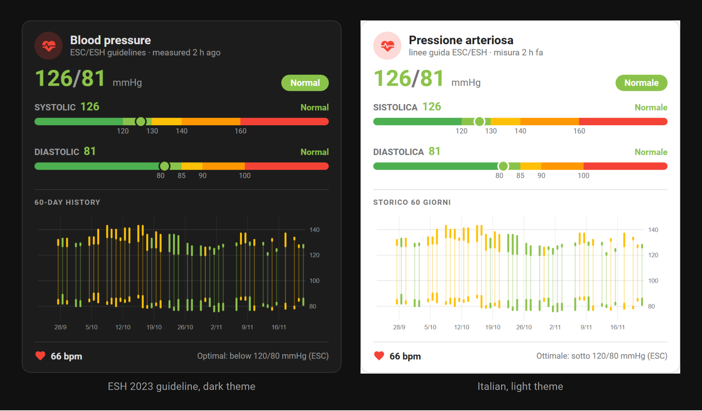

# Blood Pressure Card

[](https://hacs.xyz/docs/faq/custom_repositories/)
[](https://github.com/artech-lab/blood-pressure-card/releases)
[](https://github.com/artech-lab/blood-pressure-card/actions/workflows/validate.yml)
[](LICENSE)

**English** | [Italiano](README.it.md)

A Home Assistant dashboard card for blood pressure monitors: the last reading on the bands of the
**ESH 2023**, **ESC 2024** or **ACC/AHA 2025** guideline, its category, the pulse, a 7-day average and a
daily history. Add it and it finds your monitor by itself (Withings, Omron, Health Connect, ESPHome or
any other integration): no helpers, no YAML, no restarts.



<sub>Screenshots made with fictional demo data.</sub>

## Features

- **Zero configuration**: the systolic, diastolic and pulse sensors are found automatically, in any
  language. Pick other sensors in the visual editor if you have more than one monitor.
- **Guideline bands**: systolic and diastolic on coloured bands with the thresholds of the chosen
  guideline, the category of each value and of the reading. When the two values fall in different
  categories, the higher one applies, as all three guidelines prescribe.
- **Daily history** (7–365 days): one capsule per value from the lowest to the highest reading of the day,
  coloured by the category of the daily mean; tooltip with min, average and max of each value.
- **Exact readings**: while the recorder keeps them (10 days by default) the history is built from the
  actual measurements; older days come from the long-term statistics. Values restored after a restart are
  not counted as measurements.
- **Optional helpers in one click**: for an exact and permanent daily history, and the time of the last
  measurement in automations. See [Optional: helpers for history and automations](#optional-helpers-for-history-and-automations).
- **Pulse**, **time of the last measurement** and an optional **7-day average**.
- **English and Italian**, following the language and date format of your Home Assistant profile.
- **Native look**: theme colours, light and dark mode, sections layout, keyboard accessible, a visual editor
  for every option.

## Requirements

- Home Assistant 2024.8 or newer.
- A blood pressure monitor that exposes systolic and diastolic pressure as sensors in **mmHg** (the pulse
  sensor is optional). For the history older than the recorder retention, the sensors need a
  `state_class`, as the sensors of most integrations have.

## Installation

### HACS (recommended)

[](https://my.home-assistant.io/redirect/hacs_repository/?owner=artech-lab&repository=blood-pressure-card&category=plugin)

1. In HACS (*Marketplace* from Home Assistant 2026.11) search for **Blood Pressure Card**. If it is not
   listed, add `https://github.com/artech-lab/blood-pressure-card` as a custom repository with type
   **Dashboard**.
2. Download it. HACS adds the dashboard resource by itself.
3. Reload the browser page.

### Manual

1. Download `blood-pressure-card.js` from the [latest release](https://github.com/artech-lab/blood-pressure-card/releases/latest)
   and copy it to `/config/www/`.
2. *Settings → Dashboards → ⋮ → Resources → Add resource*: URL `/local/blood-pressure-card.js`, type
   **JavaScript module**.
3. Reload the browser page.

## Usage

In a dashboard: *Edit → Add card → Blood Pressure Card*. Nothing else is needed:

```yaml
type: custom:blood-pressure-card
```

Tap the values or a band to open the sensor, the heart to open the pulse sensor. Hover or touch the
history for the details of a day.

## Configuration

Every option is optional and available in the visual editor.

| Option | Default | Description |
| --- | --- | --- |
| `systolic_entity` | found automatically | Systolic pressure sensor (mmHg). |
| `diastolic_entity` | found automatically | Diastolic pressure sensor (mmHg). |
| `pulse_entity` | found on the same device | Pulse sensor (bpm). Only guessed when the pressure sensors are not configured. |
| `guideline` | `esh_2023` (`acc_aha_2025` if the country of Home Assistant is the United States) | `esh_2023`, `esc_2024` or `acc_aha_2025`. |
| `title` | "Blood pressure" (localized) | Card title. |
| `icon` | `mdi:heart-pulse` | Header icon. |
| `history_days` | `60` | Days in the history chart (7–365). |
| `show_history` | `true` | Daily history chart. |
| `show_average` | `false` | 7-day average: mean of the daily means of the last 7 days. |
| `show_reference` | `true` | Upper limit of the lowest category of the guideline. |
| `last_entity` | – | `input_datetime` with the date and time of the last measurement ([helpers](#optional-helpers-for-history-and-automations)). |
| `systolic_today_entity` | – | Sensor with today's systolic value, whose daily statistics feed the history ([helpers](#optional-helpers-for-history-and-automations)). |
| `diastolic_today_entity` | – | Sensor with today's diastolic value, whose daily statistics feed the history ([helpers](#optional-helpers-for-history-and-automations)). |

See [`examples/`](examples) for a full configuration. The options `sys_entity` and `dia_entity` of earlier
inline versions of the card still work; the visual editor renames them when saving.

## The guidelines

Values in mmHg. A reading takes the higher category reached by either value.

**ESH 2023** (European Society of Hypertension) [1]

| Category | Systolic | | Diastolic |
| --- | --- | --- | --- |
| Optimal | < 120 | and | < 80 |
| Normal | 120–129 | and/or | 80–84 |
| High-normal | 130–139 | and/or | 85–89 |
| Hypertension grade 1 | 140–159 | and/or | 90–99 |
| Hypertension grade 2 | 160–179 | and/or | 100–109 |
| Hypertension grade 3 | ≥ 180 | and/or | ≥ 110 |

The ESH bands have five segments on the scales 90–190 and 50–120 mmHg: grade 3 has no segment of
its own, so a reading of 180/110 or more sits at the end of the red segment and is labelled *Hypertension 3*.

**ESC 2024** (European Society of Cardiology) [2]

| Category | Systolic | | Diastolic |
| --- | --- | --- | --- |
| Non-elevated | < 120 | and | < 70 |
| Elevated | 120–139 | or | 70–89 |
| Hypertension | ≥ 140 | or | ≥ 90 |

**ACC/AHA 2025** (American College of Cardiology / American Heart Association, same categories as
2017) [3]

| Category | Systolic | | Diastolic |
| --- | --- | --- | --- |
| Normal | < 120 | and | < 80 |
| Elevated | 120–129 | and | < 80 |
| Hypertension stage 1 | 130–139 | or | 80–89 |
| Hypertension stage 2 | ≥ 140 | or | ≥ 90 |

## How the monitor and the readings are found

- **Sensors**: sensors in mmHg whose entity id, name or translation key contains *systolic* / *diastolic*
  (also *sistolica* / *diastolica*), preferring a pair on the same device; the pulse is a bpm sensor of the
  same device, preferring *pulse* over *heart rate* and skipping averages. Hidden and diagnostic entities
  are ignored.
- **Readings**: a reading is a change of the systolic or diastolic value; changes less than 2 minutes apart
  form one reading, because many integrations update the two values separately. A value that comes back
  unchanged after a restart or after `unavailable` is not a reading.
- **Older days**: before the start of the recorder history the card uses the daily long-term statistics
  and shows only the days in which the value moved (a flat day is the previous reading carried over). These
  days can include the previous reading in their range, and the mean is weighted by time.
- **With the helpers** (optional), the daily statistics of the two "today" sensors come first. In order of
  precedence, for each day:
  - after the first day of the recorder history: the exact readings, then the helpers;
  - on that first day, whose history can be partial: the helpers, then the readings, then the statistics;
  - before it: the helpers and, only for the days before the first helper day, the statistics of the
    monitor's sensors.
- **Last measurement**: the time of the last reading in the recorder history, or the time stored in the
  `input_datetime` helper when it is more recent.

## Optional: helpers for history and automations

The card works without helpers, as in version 1.0. They solve one limit of the long-term statistics: the
sensors of a monitor keep their last value until the next reading, so their daily statistics carry it over
every day. Days without readings are flat, a day with a reading also includes the previous value, and the
mean is weighted by time.

Edit the card and press **Create helpers** at the bottom of the editor (administrators only). In one click
the card:

- creates an `input_datetime` *Blood pressure last measurement* (`input_datetime.blood_pressure_last_measurement`)
  and sets it to the time of the last reading found in the recorder history of the last 30 days, or to
  2000-01-01 00:00 ("never measured");
- creates an automation *Blood pressure record measurement* that sets it at every new measurement, skipping
  values restored after a restart and attribute-only changes;
- creates two template sensors, *Blood pressure systolic today* and *Blood pressure diastolic today*
  (`sensor.blood_pressure_systolic_today`, `sensor.blood_pressure_diastolic_today`, mmHg,
  `state_class: measurement`). They have the value of the monitor only on the day of the last measurement
  and are unknown on other days, so their daily long-term statistics are exact: one row per day with
  readings, with the real minimum and maximum. The recorder purge does not remove them;
- links the `input_datetime` and the two sensors to the card. Then save the card.

The names are fixed English strings in every language, so entity ids are predictable. Helpers and an
automation that are already linked, or that already exist with the same names, are reused: pressing the
button again never creates duplicates, and after an error it continues where it stopped. The sensors are
built on the systolic and diastolic sensors chosen in the card (or found automatically); if you change
monitor, delete the helpers and create them again.

The daily statistics build up from the day of the creation on: older days still come from the statistics of
the monitor's sensors. The `input_datetime` is also handy in automations, for example to remind you if you
have not measured today.

To remove them: delete the two sensors and the `input_datetime` in *Settings → Devices & services →
Helpers*, the automation in *Settings → Automations & scenes*, and clear the three options in the editor.
If you prefer YAML, the package [`examples/packages/blood_pressure.yaml`](examples/packages/blood_pressure.yaml)
creates the same entities (replace the placeholder sensors with yours).

## Languages

English and Italian, for the card and the visual editor. The language follows the Home Assistant profile;
any other language falls back to English. Contributions of new languages are welcome: add a dictionary to
`BPC_I18N` with the same keys as `en`.

## Troubleshooting

- **"No blood pressure sensors found"** — the sensors must report `mmHg` as unit. Pick them in the editor.
- **The card is not in the card picker** — reload the browser page with a cleared cache after installing or
  updating.
- **A measurement is missing** — a new measurement with exactly the same values as the previous one does not
  change the sensors and cannot be seen.
- **No history before the last days** — the sensors need a `state_class` for Home Assistant to keep
  long-term statistics; without it only the recorder history is available.
- **No "Create helpers" button** — only administrators can create helpers; ask one to press it once.
- **"Could not create every helper"** — the helpers created before the error stay linked. Fix the cause shown
  in the message, then press the button again: it continues where it stopped.
- **Two copies loaded** — the browser console warns when the card is loaded twice (for example a manual
  resource and HACS): keep only `/hacsfiles/blood-pressure-card/blood-pressure-card.js`.

## Development

```bash
npm test             # unit tests of discovery, classification, history, helpers and translations (Node 20+)
npm install && npx playwright install chromium   # once, for the two commands below
npm run test:e2e     # browser tests with a simulated Home Assistant
npm run screenshots  # regenerates the images in images/ with demo data
```

The project includes a [`CLAUDE.md`](CLAUDE.md) guide and slash commands for
[Claude Code](https://claude.com/claude-code) (`/publish`, `/release`).

## Disclaimer

The categories are defined for blood pressure measured in a doctor's office. Home readings are usually
lower, and the guidelines diagnose hypertension from the mean of several days of home measurements (for
ESH, ≥ 135/85 mmHg). This card is a tracking aid, not a medical device: it does not diagnose anything.
Talk to your doctor about your readings. Withings, Omron and other names are trademarks of their
respective owners; this project is not affiliated with them.

## References

1. Mancia G. et al. *2023 ESH Guidelines for the management of arterial hypertension.* Journal of
   Hypertension, 2023. [doi:10.1097/HJH.0000000000003480](https://doi.org/10.1097/HJH.0000000000003480)
2. McEvoy J. W. et al. *2024 ESC Guidelines for the management of elevated blood pressure and
   hypertension.* European Heart Journal, 2024.
   [doi:10.1093/eurheartj/ehae178](https://doi.org/10.1093/eurheartj/ehae178)
3. Jones D. W. et al. *2025 AHA/ACC/AANP/AAPA/ABC/ACCP/ACPM/AGS/AMA/ASPC/NMA/PCNA/SGIM Guideline for the
   Prevention, Detection, Evaluation, and Management of High Blood Pressure in Adults.* Circulation, 2025.
   [doi:10.1161/CIR.0000000000001356](https://doi.org/10.1161/CIR.0000000000001356)

## License

Copyright © 2026 The blood-pressure-card contributors. Released under the
[GNU General Public License v3.0 or later](LICENSE).
